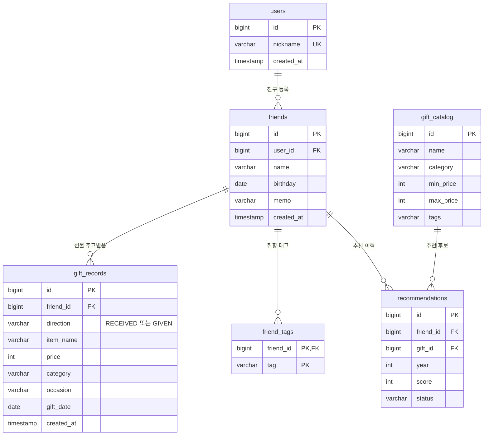
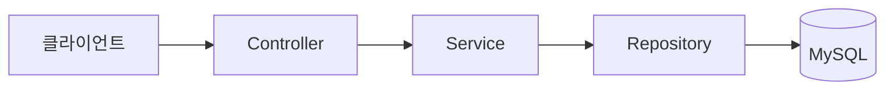

# 🎁 다음 차례

> **받은 만큼 돌려주는 생일선물 장부**
> 친구의 생일과 받은 선물을 기록해 두면, 생일이 다가올 때 받은 만큼에 맞는 답례 선물을 추천해 주는 백엔드 서비스

**작성자:** (이름 입력) · **진행 상황:** 1주차 / 총 4주

---

## 1. 기획 의도

친구에게 생일선물을 받았을 때, 정작 그 친구의 생일이 오면 "얼마짜리로 돌려줘야 하지?" 하고 고민하게 됩니다. 기억에 의존하면 받은 만큼 챙기기 어렵고, 선물을 고르는 데도 시간이 오래 걸립니다.

**다음 차례**는 친구 한 명 한 명과 주고받은 선물을 기록해서 이 문제를 풉니다.

- 친구의 생일과 취향을 등록한다
- 친구가 준 선물과 내가 준 선물을 가격과 함께 기록한다
- 생일이 다가오면 받은 만큼에 맞는 답례 선물을 추천받는다

금융·쇼핑 API 연동 없이 모든 기록을 직접 입력하는 방식이고, 화면보다 **서버의 계산 로직**(잔액 계산, 추천 점수, 생일 스케줄러)이 핵심인 백엔드 중심 프로젝트입니다.

## 2. 기술 스택

| 구분 | 사용 기술 |
|---|---|
| Language | Java |
| Framework | Spring Boot 4.x, Spring Web MVC |
| Data | Spring Data JPA (Hibernate), MySQL |
| Validation | Jakarta Bean Validation |
| Build | Gradle |
| 기타 | Lombok, IntelliJ IDEA |

## 3. 전체 개발 일정

| 주차 | 내용 | 상태 |
|---|---|---|
| **1주차** | 기획 확정, ERD, API 명세, 프로젝트 세팅, 사용자·친구·선물 기록 API | ✅ 이번 발표 범위 |
| 2주차 | 받은 만큼 vs 준 만큼 잔액 계산, 다가오는 생일 조회, 선물 후보 DB 구축 | 예정 |
| 3주차 | 추천 점수 알고리즘, 중복 방지, 생일 D-day 스케줄러, 테스트 코드 | 예정 |
| 4주차 | 간단한 화면, 배포, 최종 발표 | 예정 |

---

# 📌 1주차 결과

## 4. ERD

전체 6개 테이블을 설계했고, **1주차에는 `users`, `friends`, `gift_records` 3개를 구현**했습니다. 나머지 3개(`friend_tags`, `gift_catalog`, `recommendations`)는 2~3주차에 구현합니다.



## 5. 프로젝트 구조

기능별로 패키지를 나누고, 각 기능 안에서 **Controller → Service → Repository** 계층으로 역할을 분리했습니다.

```
src/main/java/com/nextturn/demo
├─ DemoApplication.java
├─ user     User, UserRepository, UserService, UserController, UserCreateRequest, UserResponse
├─ friend   Friend, FriendRepository, FriendService, FriendController, FriendCreateRequest, FriendResponse
└─ gift     GiftRecord, Direction, GiftRecordRepository, GiftService, GiftController, GiftCreateRequest, GiftResponse
```



| 계층 | 역할 |
|---|---|
| Controller | 요청을 받고 입력값을 검증(`@Valid`)한 뒤 Service에 전달 |
| Service | 소유권 확인, 생일 계산 같은 규칙 처리, 트랜잭션 관리 |
| Repository | Spring Data JPA로 DB 접근 |

## 6. API 명세

모든 요청(가입 제외)은 헤더 `X-User-Id`로 "누구의 요청인지"를 구분합니다. (1주차 임시 인증 방식)

| 기능 | 메서드·경로 | 성공 | 실패 |
|---|---|---|---|
| 사용자 가입 | `POST /api/users` | 201 | 400 입력 오류, 409 닉네임 중복 |
| 친구 등록 | `POST /api/friends` | 201 | 400 입력 오류, 404 사용자 없음 |
| 친구 목록 (다음 생일 순) | `GET /api/friends` | 200 | - |
| 선물 기록 | `POST /api/friends/{friendId}/gifts` | 201 | 400, 403 내 친구 아님, 404 |
| 선물 이력 조회 (최신순) | `GET /api/friends/{friendId}/gifts` | 200 | 403, 404 |
| 선물 기록 삭제 | `DELETE /api/gifts/{giftId}` | 204 | 403 내 기록 아님, 404 |

### 요청·응답 예시

**친구 등록** `POST /api/friends`

```json
// 요청
{ "name": "지현", "birthday": "2003-12-05", "memo": "대학 동기" }

// 응답 201
{ "id": 1, "name": "지현", "birthday": "2003-12-05", "memo": "대학 동기", "daysUntilBirthday": 24 }
```

**받은 선물 기록** `POST /api/friends/1/gifts`

```json
// 요청
{
  "direction": "RECEIVED",
  "itemName": "립밤 세트",
  "price": 15000,
  "category": "뷰티",
  "occasion": "BIRTHDAY",
  "giftDate": "2026-05-20"
}

// 응답 201
{
  "id": 1, "direction": "RECEIVED", "itemName": "립밤 세트", "price": 15000,
  "category": "뷰티", "occasion": "BIRTHDAY", "giftDate": "2026-05-20"
}
```

## 7. 구현 포인트

- **다음 생일까지 남은 일수 계산**: 올해 생일이 이미 지났으면 내년 생일을 기준으로 계산하고, 친구 목록을 생일이 가까운 순으로 정렬합니다. 이 정렬이 이후 "곧 생일인 친구" 기능의 기반이 됩니다.
- **소유권 검증**: 다른 사용자의 친구나 선물 기록에 접근하면 `403`을 반환해서 남의 데이터를 보호합니다.
- **입력 검증**: 이름 누락, 음수 가격, 잘못된 `direction` 값 등은 `400`으로 걸러냅니다.
- **DTO 분리**: 엔티티를 그대로 노출하지 않고 요청·응답용 `record`를 따로 두었습니다.
- **비밀번호 분리**: DB 비밀번호는 코드에 쓰지 않고 환경변수 `DB_PASSWORD`로 주입해서 GitHub에 올라가지 않게 했습니다.
- **현재 한계**: `X-User-Id` 헤더는 누구나 바꿔서 보낼 수 있는 임시 방식입니다. 로그인과 토큰 인증은 이후 단계에서 교체할 계획입니다.

## 8. 실행 방법

1. **MySQL 준비**: Workbench에서 `db/init.sql`을 실행해 `nextturn` DB와 계정을 만듭니다.
2. **환경변수 설정**: 실행 환경에 `DB_PASSWORD=비밀번호`를 추가합니다. (IntelliJ: Run Configuration > Environment variables)
3. **실행**: `DemoApplication`을 실행하면 서버가 `http://localhost:8080`에서 시작되고, JPA가 테이블을 자동 생성합니다.
4. **테스트**: `test.http`의 요청을 위에서부터 차례로 실행합니다.

## 9. 테스트 결과

`test.http`로 아래 시나리오를 확인했습니다.

| 시나리오 | 기대 결과 | 확인 |
|---|---|---|
| 사용자 가입 | 201, `id` 발급 | ☐ |
| 친구 등록 → 목록 조회 | 201, 생일 가까운 순으로 정렬 | ☐ |
| 받은 선물 기록 → 이력 조회 | 201, 최신순 조회 | ☐ |
| 선물 기록 삭제 | 204 | ☐ |
| 이름 없이 친구 등록 | 400 | ☐ |
| 없는 친구 번호로 요청 | 404 | ☐ |
| 다른 사용자(`X-User-Id: 2`)가 남의 친구 조회 | 403 | ☐ |

<!-- 아래에 실행 캡처 이미지를 추가하세요. docs/images 폴더에 넣으면 됩니다.


-->

## 10. 트러블슈팅

| 문제 | 원인 | 해결 |
|---|---|---|
| Spring Initializr에 Boot 3.x가 없음 | 4.x가 최신 안정 버전으로 올라옴 | 최신 4.x를 선택. JPA·검증 코드는 그대로 사용 |
| Gradle 동기화 실패, 실행 버튼(▶)이 안 뜸 | `build.gradle`이 요구하는 Java 버전과 설치된 JDK 버전이 달라 Gradle이 JDK를 찾지 못함 (`Toolchain download repositories have not been configured`) | `build.gradle`의 `JavaLanguageVersion.of(...)` 숫자를 설치된 JDK 버전에 맞추고 Gradle 재동기화 |
| 직접 만든 패키지가 인식되지 않을 위험 | Spring Boot는 `DemoApplication`이 있는 패키지와 그 하위 패키지만 스캔 | `user`, `friend`, `gift`를 `com.nextturn.demo` 아래에 생성 |
| 테이블 이름이 ERD와 다르게 생성 | 엔티티 이름 기준으로 `friend`가 만들어짐 | `@Table(name = "friends")`로 이름 명시 |

## 11. 다음 주(2주차) 계획

- 친구별 **받은 금액 − 준 금액** 잔액 계산 API (`GET /api/friends/{id}/balance`)
- **다가오는 생일** 조회 API (`GET /api/birthdays/upcoming`)
- 추천에 쓸 **선물 후보 DB(`gift_catalog`)** 구축, 친구 **취향 태그** 설정 API
